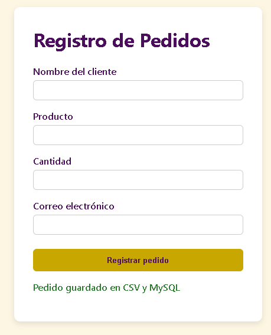
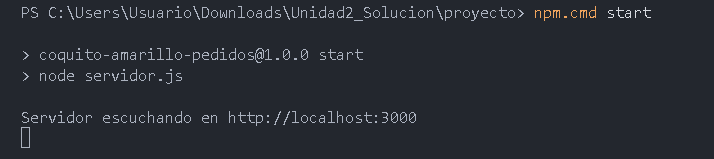
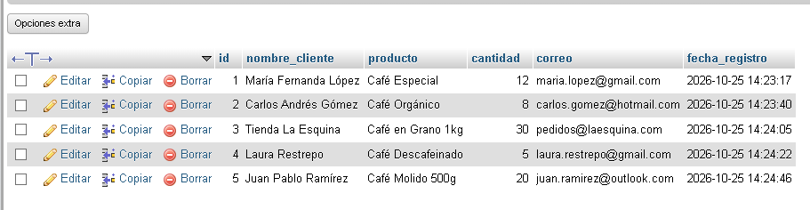

# Sistema de captura y persistencia de datos — Coquito Amarillo S.A.S.

Aplicación web de registro de pedidos. El formulario envía los datos a un servidor Node.js (Express) que los guarda en un archivo `Datos.csv` y en una base de datos MySQL.

**Autor:** Juan José Bustamante Jiménez — Ingeniería de Software — Lenguajes de Programación

## Estructura del repositorio

```
coquito-amarillo-pedidos/
├── servidor.js        # Backend (Node.js + Express) con clases en JavaScript
├── database.sql       # Script de creación de la base de datos y la tabla
├── Datos.csv          # Registros de prueba (5 pedidos)
├── package.json       # Dependencias del proyecto
├── public/            # Frontend
│   ├── formulario.html
│   ├── estilos.css
│   └── app.js
└── capturas/          # Evidencias de las pruebas
```

## Requisitos

- Node.js 18 o superior
- MySQL 8 (o MySQL de XAMPP) en ejecución

## Instalación y ejecución

1. Clonar o descargar el repositorio y abrir la carpeta en una terminal.
2. Instalar dependencias:
   ```
   npm install
   ```
   En Windows PowerShell, si aparece un error de scripts deshabilitados, usar `npm.cmd install`.
3. Crear la base de datos y la tabla ejecutando `database.sql` (por ejemplo en phpMyAdmin, pestaña SQL, o con `mysql -u root -p < database.sql`).
4. (Opcional) Configurar las credenciales por variables de entorno: `DB_HOST`, `DB_USER`, `DB_PASSWORD`, `DB_NAME`. Por defecto: `localhost`, `root`, contraseña vacía y `coquito_amarillo`.
5. Iniciar el servidor:
   ```
   npm start
   ```
   (en PowerShell: `npm.cmd start`). Debe mostrar `Servidor escuchando en http://localhost:3000`.
6. Abrir `http://localhost:3000` en el navegador, llenar el formulario y presionar **Registrar pedido**.

## Cómo funciona

1. El formulario valida en el navegador (`required`, `type`, `min`).
2. `app.js` envía los datos por `fetch` a `POST /registrar`.
3. El servidor crea un objeto `RegistroPedido`, valida los datos (tipos y decisiones) y lo guarda en `Datos.csv` y en MySQL.
4. Responde con un mensaje de éxito (`201`), de datos inválidos (`400`) o de error de guardado (`500`).

## Decisiones de diseño

- **Clase `RegistroPedido`:** encapsula los datos, la validación y el formato CSV (con método estático privado que escapa comas y comillas).
- **Repositorios separados** (`RepositorioCSV`, `RepositorioMySQL`): cada clase se encarga de un único destino de datos.
- **`fs.appendFile`:** agrega registros sin sobrescribir; el encabezado se crea una sola vez.
- **Consultas parametrizadas (`?`):** evitan la inyección SQL.
- **`Promise.allSettled`:** se intenta guardar en ambos destinos y se informa cuál falló.

## Capturas de las pruebas

**1. Formulario con el mensaje de confirmación**



**2. Consola con el servidor en ejecución**



**3. Tabla `registros` en MySQL con los 5 pedidos de prueba**


